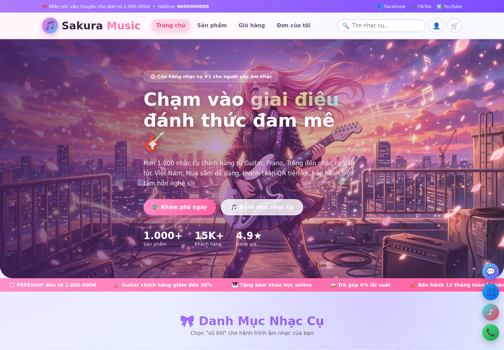
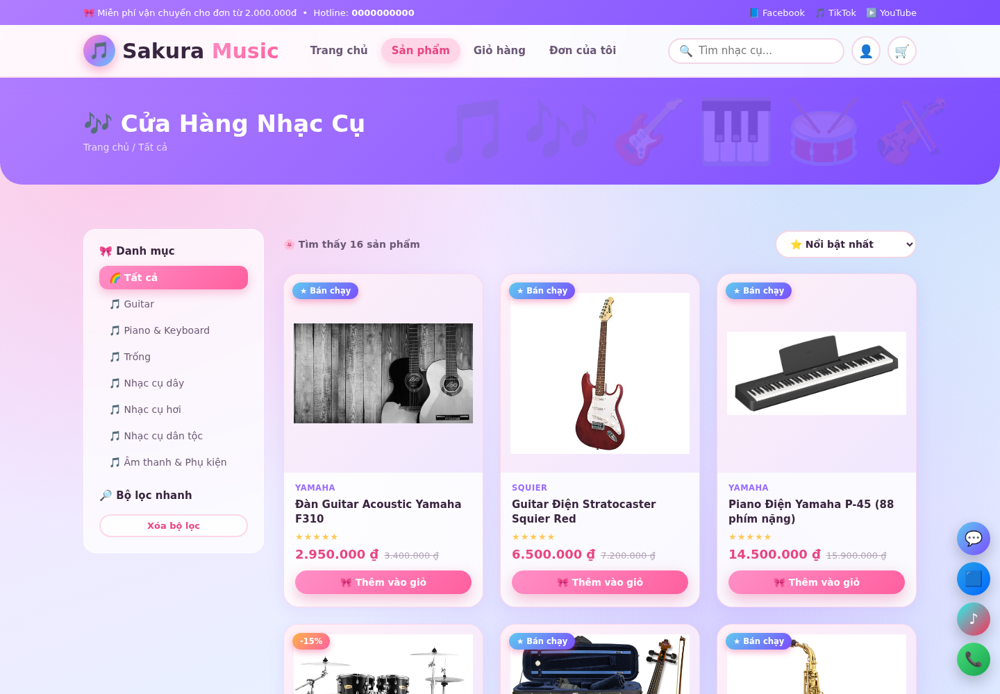
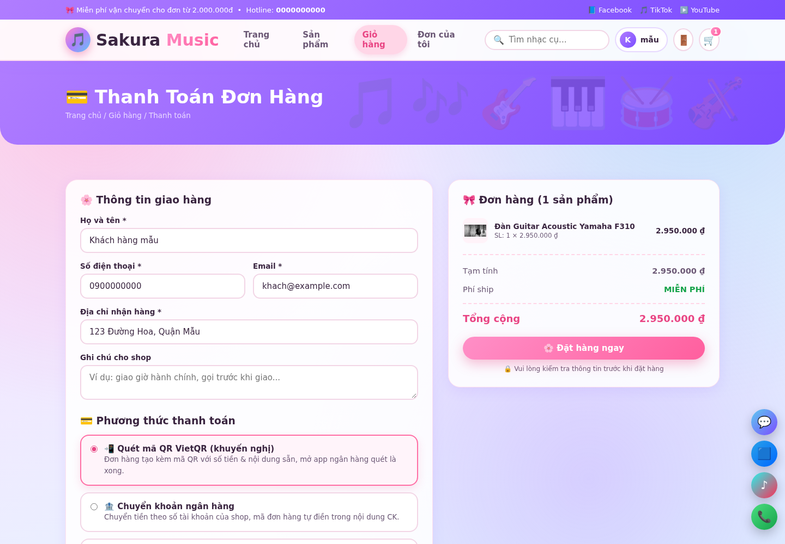
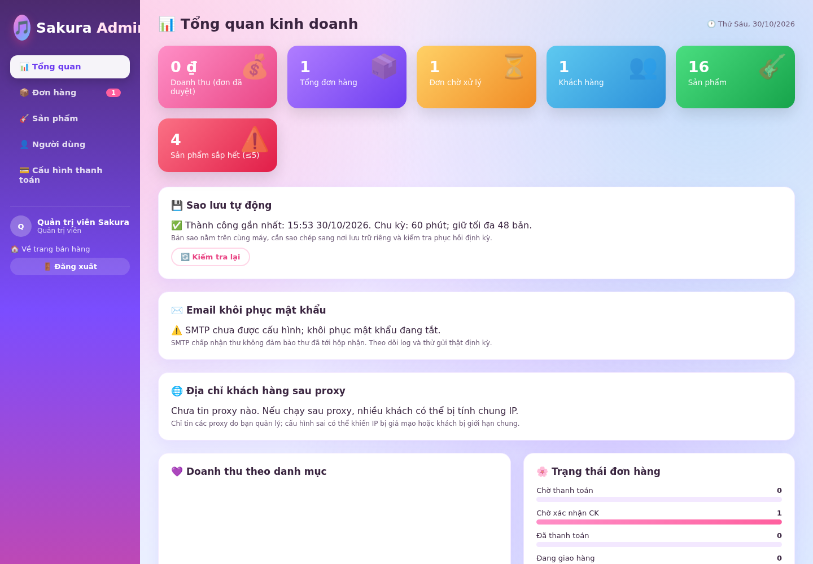
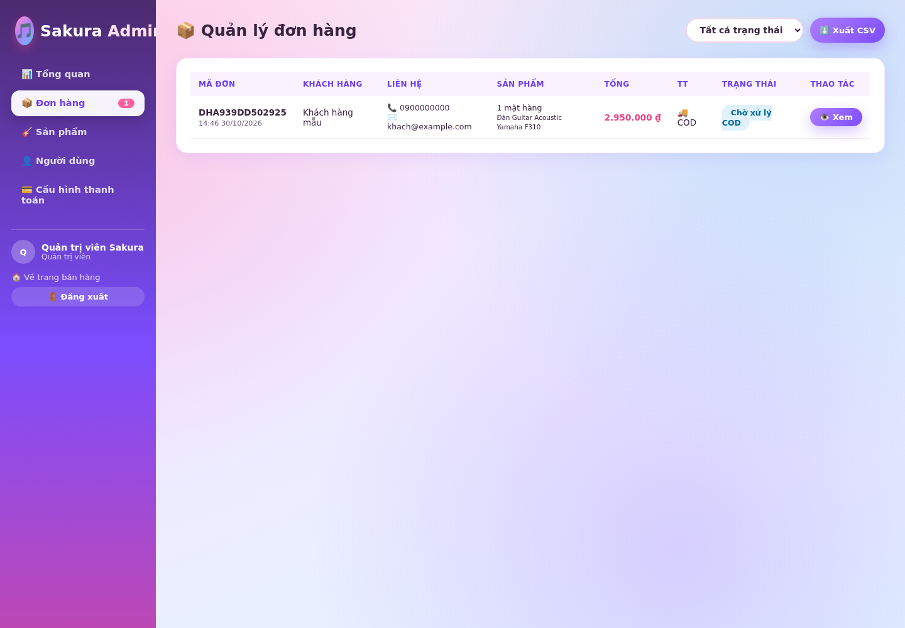

# 🌸 Sakura Music Shop — Website Bán Nhạc Cụ Phong Cách Anime

Website thương mại điện tử bán nhạc cụ: **Node.js + Express + HTML/CSS/JavaScript thuần**,
giao diện phong cách anime (hoa anh đào rơi, gradient hồng-tím, hiệu ứng kính mờ),
đầy đủ đăng ký/đăng nhập, giỏ hàng, thanh toán **QR VietQR / chuyển khoản / COD**,
và **trang quản trị admin** quản lý đơn hàng, sản phẩm, khách hàng, doanh thu.
Chuyển khoản được **đối soát thủ công**; dự án chưa tự xác minh giao dịch ngân hàng.

 

---

## 🖼️ Giao diện & chức năng

Ảnh chụp từ ứng dụng đang chạy với **cơ sở dữ liệu tạm và thông tin minh họa**, không phải khách hàng, đơn hàng hay tài khoản ngân hàng thật. Số liệu quảng bá trong giao diện là nội dung mẫu. Ảnh được chụp khi chặn dịch vụ ngoài: biểu đồ dựa trên Chart.js và QR trực tuyến cần kết nối mạng để hiển thị.

### Trang chủ

Banner, danh mục nhạc cụ và lối vào cửa hàng.



### Danh sách sản phẩm

Tìm kiếm, lọc danh mục, sắp xếp và thêm sản phẩm vào giỏ.



### Thanh toán

Nhập thông tin giao hàng, xem tổng tiền và chọn QR, chuyển khoản hoặc COD. Giá, số lượng và tồn kho được kiểm tra lại khi đặt hàng.



### Quản trị

Dashboard thống kê và hiển thị trạng thái sao lưu, email và cấu hình proxy của tiến trình hiện tại.



Quản lý đơn hàng, lọc trạng thái và xuất CSV; trạng thái thanh toán do cửa hàng đối soát.



### Giao diện điện thoại


Để chụp lại ảnh trên máy phát triển, cài các dependency và Chromium/Chrome, sau đó chạy `CHROMIUM_PATH=/đường/dẫn/chromium node scripts/capture-readme.js`. Script tạo dữ liệu trong thư mục tạm, thay thông tin ngân hàng/hotline bằng giá trị mẫu và chặn truy cập dịch vụ ngoài; hình ảnh và font có thể khác tùy máy.

## 📌 1. Yêu cầu

- [Node.js](https://nodejs.org) phiên bản **22.13 trở lên** với `node:sqlite` (API này có thể hiện cảnh báo experimental tùy phiên bản Node).
- Trình soạn thảo bất kỳ (VSCode là tùy chọn).
- Trình duyệt hiện đại hỗ trợ **Web Locks**; thanh toán cần HTTPS hoặc localhost. Nếu thiếu Web Locks, trang thanh toán sẽ không gửi đơn.

## 🚀 2. Cách chạy trên VSCode (làm lần lượt)

1. Mở **VSCode** → `File > Open Folder...` → chọn thư mục **`sakura-music`**.
2. Mở terminal trong VSCode: menu **Terminal → New Terminal** (phím tắt `` Ctrl+` ``).
3. Cài thư viện:

   ```bash
   npm ci
   ```

4. Khởi động server:

   ```bash
   npm start
   ```

5. Mở trình duyệt truy cập:

   | Trang | Đường link |
   |---|---|
   | 🏠 Trang chủ khách hàng | http://localhost:3000 |
   | 🛍️ Tất cả sản phẩm | http://localhost:3000/products.html |
   | 👑 **Trang quản trị admin** | http://localhost:3000/admin.html |

6. Dừng server: nhấn `Ctrl + C` trong terminal.

> 💡 Mẹo: nên cài extension **Live Server** thì **KHÔNG cần** — dự án này phải chạy bằng
> `npm start` vì có server backend xử lý đăng nhập, đơn hàng, QR.

## 👤 3. Tài khoản quản trị

Khi tạo cơ sở dữ liệu mới, admin có email `admin@sakura.vn`. Đặt biến môi trường
`ADMIN_PASSWORD` (ít nhất 12 ký tự, tối đa 72 byte) trước lần chạy đầu tiên. Trong production, biến này là bắt buộc khi tạo dữ liệu mới; ngoài production, nếu không đặt, server sinh mật khẩu ngẫu nhiên và in **một lần** trong log khởi tạo. Tự đăng ký tài khoản khách.

Với dữ liệu được nhập từ `data/db.json` của phiên bản cũ, mật khẩu cũ vẫn giữ nguyên: hãy đổi mật khẩu
admin ngay và xóa/đổi mật khẩu tài khoản demo nếu có. Không xóa file dữ liệu nếu cần giữ đơn hàng.

---

## 🧩 4. Các chức năng đã có

### Phía khách hàng
- ✅ Trang chủ: banner anime, danh mục, sản phẩm bán chạy, khuyến mãi, chính sách
- ✅ Danh sách sản phẩm: tìm kiếm, lọc theo danh mục, sắp xếp theo giá / đánh giá
- ✅ Trang chi tiết sản phẩm: ảnh, mô tả, sao đánh giá, chọn số lượng, mua ngay
- ✼ Giỏ hàng lưu trên trình duyệt (localStorage), cập nhật số lượng, phí ship, freeship từ 2 triệu
- ✅ **Đăng ký / Đăng nhập / Đăng xuất** (mật khẩu mã hóa bcrypt, phiên đăng nhập)
- ✅ **Quên mật khẩu**: sau khi cấu hình SMTP, nhận mã 6 số (hiệu lực 15 phút) → đặt mật khẩu mới; mỗi mã chỉ dùng 1 lần
- ✅ Giới hạn yêu cầu đăng nhập và khôi phục mật khẩu theo IP/email; xem các ngưỡng và lưu ý proxy tại mục 9 và 12.
- ✅ Trang tài khoản: sửa hồ sơ, đổi mật khẩu, xem & hủy đơn, xem lại QR để thanh toán
- ✅ **Thanh toán: QR VietQR động, chuyển khoản ngân hàng, COD**
  - Mã QR tự điền **số tiền + nội dung chuyển khoản theo mã đơn**
  - Nút "Tôi đã chuyển khoản" chỉ báo shop đối soát, **không tự xác nhận tiền đã đến**
- ✅ Liên kết **Facebook, Zalo, TikTok, YouTube, Instagram** (nút nổi góc màn hình + chân trang)
- ✅ Hiệu ứng: hoa anh đào rơi, nốt nhạc bay, marquee, hover lấp lánh, toast thông báo, responsive mobile

### Phía admin (`/admin.html`)
- 🔐 **Trang đăng nhập quản trị riêng `/admin-login.html` — BẮT BUỘC**: không có tài khoản admin thì không thể vào trang quản trị; tài khoản khách hàng bị từ chối ngay cả khi đã đăng nhập (API phía server cũng kiểm tra quyền, không thể vượt rào chỉ bằng cách gõ URL)
- 🔑 Admin **đặt lại mật khẩu** cho bất kỳ tài khoản khách nào ngay trong mục Người dùng
- 📊 **Dashboard**: doanh thu, số đơn, khách hàng, sản phẩm sắp hết hàng, biểu đồ doanh thu theo danh mục, đơn mới nhất
- 📦 **Quản lý đơn hàng**: xem chi tiết, lọc theo trạng thái, cập nhật trạng thái
  (chờ thanh toán / chờ xác nhận → đã thanh toán → đang giao → hoàn thành; COD có luồng riêng), xuất file **CSV** mở bằng Excel
- 🎸 **Quản lý sản phẩm**: thêm / sửa / xóa, sửa giá, kho, ảnh, mô tả
- 👤 **Quản lý người dùng**: xem số đơn, tổng chi tiêu, xóa tài khoản khách
- 💳 Trang cấu hình hiển thị thông tin tài khoản ngân hàng & link mạng xã hội
- 💾 Trang tổng quan hiển thị trạng thái sao lưu, SMTP và proxy của tiến trình hiện tại; không thay thế giám sát độc lập.

## 🗂️ 5. Cấu trúc thư mục

```
sakura-music/
├── server.js               # Backend Express: API, xác thực, đơn hàng, admin
├── package.json
├── Dockerfile, compose.yaml # Cấu hình Docker một tiến trình
├── lib/                    # SQLite, sao lưu, giới hạn truy cập, proxy
├── scripts/                # Sao lưu/phục hồi và chụp ảnh README
├── test/, e2e/             # Kiểm thử API và trình duyệt
├── docs/                   # Checklist, hướng dẫn và ảnh giao diện
├── data/
│   ├── db.sqlite           # SQLite (tự sinh khi chạy lần đầu)
│   ├── db.json             # Dữ liệu cũ, giữ lại sau khi nhập nếu có
│   └── auto-backups/       # Sao lưu tự động (chứa thông tin nhạy cảm)
├── node_modules/           # Thư viện (do npm install tạo ra)
└── public/                 # Toàn bộ giao diện
    ├── index.html          # Trang chủ
    ├── products.html       # Danh sách sản phẩm
    ├── product.html        # Chi tiết sản phẩm
    ├── cart.html           # Giỏ hàng
    ├── checkout.html       # Thanh toán QR / chuyển khoản / COD
    ├── login.html          # Đăng nhập khách hàng
    ├── register.html       # Đăng ký
    ├── forgot-password.html # Quên mật khẩu (mã xác nhận)
    ├── account.html        # Tài khoản khách + đơn hàng
    ├── admin-login.html    # 🔐 Trang đăng nhập RIÊNG của admin
    ├── admin.html          # Trang quản trị (tự đá về admin-login nếu chưa đăng nhập admin)
    ├── css/style.css       # Toàn bộ style anime
    ├── js/                 # JS từng trang + common.js dùng chung
    └── assets/img/         # Ảnh nền anime + 16 ảnh sản phẩm
```

## 💳 6. Thay tài khoản ngân hàng nhận tiền thật (QUAN TRỌNG)

Thông tin ngân hàng hiện được cấu hình trong `server.js`; hãy kiểm tra kỹ trước khi nhận tiền.
Để nhận tiền thật, mở file **`server.js`**, tìm khối `const BANK = { ... }` ở gần đầu file và sửa:

```js
const BANK = {
  bankCode: 'MB',                 // Mã ngân hàng (xem bảng bên dưới)
  bankName: 'Ngân hàng TMCP Quân đội (MB Bank)',
  shortName: 'MB Bank',
  accountNo: '0987654321',        // 👉 SỐ TÀI KHOẢN THẬT của bạn
  accountName: 'NGUYEN VAN A',    // 👉 TÊN CHỦ TK in hoa, không dấu
  hotline: '1900 6868',
  ...
};
```

Một số mã ngân hàng hay dùng cho dịch vụ **VietQR.io**:

| Ngân hàng | Mã |
|---|---|
| Vietcombank | `VCB` |
| VietinBank | `VTB` (hoặc `ICB`) |
| BIDV | `BIDV` |
| Techcombank | `TCB` |
| MB Bank | `MB` |
| ACB | `ACB` |
| TPBank | `TPB` |
| Agribank | `VBA` |
| Sacombank | `STB` |

Lưu ý: tên chủ tài khoản phải **in hoa, không dấu** đúng như ngân hàng khai báo.
Ảnh QR được tạo tự động qua dịch vụ miễn phí **https://img.vietqr.io** (cần có mạng khi xem QR).

## 🔗 7. Thay link mạng xã hội của shop

Trong `server.js`, hàm route `app.get('/api/config', ...)` sửa lại các link:

```js
social: {
  facebook:  'https://facebook.com/TRANG-CUA-BAN',
  zalo:      'https://zalo.me/SĐT-CỦA-BẠN',
  tiktok:    'https://tiktok.com/@KENH-CUA-BAN',
  youtube:   'https://youtube.com/@KENH-CUA-BAN',
  instagram: 'https://instagram.com/KENH-CUA-BAN',
}
```

## 🧪 8. Quy trình thử nghiệm một đơn hàng đầy đủ

1. Đăng ký tài khoản khách.
2. Vào **Sản phẩm** → thêm vài món vào giỏ → **Thanh toán**.
3. Chọn **Quét mã QR VietQR** → bấm **Đặt hàng** → màn hình hiện mã QR + STK + nội dung CK.
4. Bấm **Tôi đã chuyển khoản** (mô phỏng đã CK; với shop thật, khách quét QR bằng app ngân hàng).
5. Đăng nhập admin (`admin@sakura.vn` và mật khẩu đã cấu hình) tại `/admin.html`:
   - Vào **Đơn hàng** → mở đơn → đổi trạng thái thành **Đã thanh toán → Đang giao → Hoàn thành**.
   - Xem doanh thu cập nhật ở **Tổng quan**, xuất CSV nếu cần.

## ✅ Checklist staging

Xem [docs/staging-checklist.md](docs/staging-checklist.md) trước khi triển khai; test đồng thời trong repo kiểm tra tính đúng, không phải cam kết sức chịu tải.

## 🔒 9. Lưu ý kỹ thuật

- Mật khẩu được băm **bcrypt**; phiên có token ngẫu nhiên và được thu hồi khi đăng xuất hoặc đổi mật khẩu.
- Quên mật khẩu mặc định **tắt** nếu chưa cấu hình SMTP. `DEMO_MODE=1` chỉ để thử cục bộ khi không cấu hình SMTP: mã được trả về API và bất kỳ ai cũng có thể chiếm tài khoản. Không bật trên mạng công khai. Chế độ demo bị vô hiệu khi `NODE_ENV=production`.
- Đăng nhập bị khóa 5 phút sau 5 lần sai cho cùng email + IP trong 5 phút; sau 20 lần sai cho cùng email từ mọi IP trong 15 phút, email bị khóa 15 phút. Ngoài ra tối đa 100 yêu cầu đăng nhập / IP / 5 phút, kể cả đăng nhập thành công. Yêu cầu mã và thử đặt lại có chung giới hạn 5 lần / email và 30 lần / IP trong 15 phút. Bộ đếm lưu trong SQLite dưới dạng khóa HMAC, tồn tại qua khởi động lại khi `SECRET` không đổi; dữ liệu bộ đếm không có trong file backup JSON nên bị xóa khi phục hồi. Giới hạn theo email có thể bị lạm dụng để tạm khóa tài khoản; cần theo dõi vận hành. Mặc định ứng dụng không tin header IP của proxy, nên khách sau cùng proxy có thể bị tính chung IP. Nếu triển khai sau proxy, cấu hình `TRUSTED_PROXIES` theo mục bên dưới; cấu hình sai có thể cho phép giả mạo IP.
- Đơn chuyển khoản đi qua chờ thanh toán → chờ xác nhận → đã thanh toán → đang giao → hoàn thành; admin có thể xác nhận thanh toán trực tiếp. Đơn COD đi từ chờ xử lý → đang giao → hoàn thành và chỉ tính doanh thu khi hoàn thành. Khách hoặc admin có thể hủy khi đơn còn `pending` hoặc `confirmed`; đơn đã hủy không thể mở lại.
- Khi đặt hàng, API `POST /api/orders` yêu cầu header `Idempotency-Key` là UUID v4, cùng `expectedPrice` trên từng dòng và `expectedTotal`. Một lần thử lại phải gửi lại cùng key và cùng nội dung JSON, theo cùng thứ tự trường: server trả `200` với `replayed: true` và đơn cũ, không trừ kho lần nữa; dùng key cũ với nội dung khác trả `409`. Đơn mới trả `201`. Key được lưu cùng đơn, theo tài khoản, và tồn tại qua khởi động lại khi dữ liệu còn nguyên.
- Trình duyệt lưu tạm yêu cầu đặt hàng (bao gồm thông tin giao hàng) trong localStorage đến khi biết kết quả. Khi mất phản hồi, mở lại trang thanh toán và chọn **Kiểm tra / tiếp tục đơn cũ**; thao tác này có thể tạo đơn nếu lần gửi trước chưa đến server. Không xóa dữ liệu trình duyệt trước khi kiểm tra. Thanh toán dùng Web Locks để ngăn gửi đồng thời từ các tab cùng tài khoản trong một trình duyệt và kiểm tra giỏ hàng cũ trước khi gửi; cần HTTPS (hoặc localhost) và trình duyệt hỗ trợ Web Locks. Server cũng kiểm tra tài khoản nếu trang thanh toán gửi header `X-Checkout-User`. Chống lặp ở server chỉ áp dụng cho cùng key: các đơn đặt độc lập từ thiết bị, hồ sơ trình duyệt hoặc tài khoản khác vẫn có thể trùng; kiến trúc lưu trữ hiện chỉ hỗ trợ một tiến trình server.
- Chạy `npm test` để kiểm tra các luồng API chính. Để kiểm thử giao diện, cài Chromium/Chrome và chạy `CHROMIUM_PATH=/đường/dẫn/chromium npm run test:browser` (dùng dữ liệu tạm, không chạm dữ liệu cửa hàng; các dịch vụ bên ngoài bị chặn trong bài test).
- Dữ liệu đang hoạt động nằm trong `data/db.sqlite`. Không xóa file nếu cần giữ tài khoản, đơn hàng và tồn kho.
- Production yêu cầu `SECRET` riêng tư, ổn định, tối thiểu 32 byte và không dùng secret mặc định cũ đã công khai. Độ dài không đảm bảo đủ mạnh: hãy dùng giá trị ngẫu nhiên có chất lượng cao, lưu trong trình quản lý bí mật, không đưa vào repo/chat. Đặt `NODE_ENV=production` và dùng HTTPS để cookie được bảo vệ bằng cờ Secure. Không có `SECRET` ngoài production thì các phiên và mã reset cũ bị vô hiệu sau khi khởi động lại.
- Server từ chối khởi động production nếu phát hiện mật khẩu demo cũ `admin123` cho admin hoặc `123456` cho `user@sakura.vn`. Hãy đổi/xóa các tài khoản cũ trong môi trường cô lập, không mở ra Internet, trước khi chuyển sang production. Kiểm tra cả những mật khẩu yếu khác: ứng dụng không thể tự phát hiện mọi mật khẩu dễ đoán.
- Khi nhận SIGTERM/SIGINT, server ngừng nhận kết nối mới và chờ tối đa 10 giây để các request đang xử lý kết thúc. Cấu hình thời gian dừng của nền tảng lớn hơn 10 giây; email gửi bất đồng bộ vẫn chưa có hàng đợi bền vững.
- SQLite lưu một snapshot JSON của toàn bộ ứng dụng và cập nhật trong transaction; dữ liệu vẫn được giữ trong bộ nhớ của một tiến trình. Khóa chỉ cho phép một server ghi, không phải cơ sở dữ liệu quan hệ đa tiến trình và không phù hợp mở rộng nhiều máy chủ. Theo dõi dung lượng và hiệu năng khi dữ liệu tăng.
- File này là dự án học tập/demo; để bán hàng thật cần bổ sung: cổng thanh toán thật (Momo/ZaloPay/Stripe),
  gửi email xác nhận, phân trang, xác thực OTP/SĐT... (có thể phát triển thêm dễ dàng trên nền code này).


## 💾 10. Sao lưu và phục hồi dữ liệu

Bản sao chứa thông tin khách hàng, đơn hàng, hash mật khẩu, phiên đăng nhập và mã khôi phục. **Lưu ở nơi riêng tư, có kiểm soát truy cập và sao chép sang nơi lưu trữ an toàn khác**; thư mục `backups/` đã được Git bỏ qua. File được tạo với quyền 0600 trên hệ thống hỗ trợ quyền Unix, nhưng không được mã hóa.

### Chuyển dữ liệu cũ

Trước khi nâng cấp, dừng bản server cũ và sao lưu `data/db.json` ra một nơi an toàn. Lần đầu chạy phiên bản này, nếu chưa có `data/db.sqlite`, server kiểm tra rồi nhập `data/db.json` vào SQLite; file JSON cũ **không bị sửa hoặc xóa**. Nếu nhập thất bại, server dừng và không tạo dữ liệu mẫu thay thế. Khi SQLite đã tồn tại, ứng dụng chỉ dùng SQLite: file JSON cũ sẽ không tự cập nhật và cũng không được nhập lại. Không chạy bản server cũ song song. Kiểm tra tài khoản, sản phẩm, tồn kho và đơn hàng sau khi nâng cấp; bảo vệ file JSON cũ vì nó có thể chứa thông tin nhạy cảm.

### Sao lưu tự động

Mặc định server tạo một bản sao khi khởi động và sau đó mỗi 60 phút trong `data/auto-backups/`, giữ tối đa 48 bản tự động mới nhất. Chỉ những file do cơ chế này đặt tên mới được tự động xóa; bản sao thủ công không bị xóa. Có thể đặt `BACKUP_INTERVAL_MINUTES` (1–10080), `BACKUP_RETENTION` (1–1000), hoặc `AUTO_BACKUP=0` để tắt. Lỗi tạo bản sao được ghi vào log nhưng không làm server dừng: cần giám sát log và dung lượng. Trang quản trị hiển thị kết quả lần thử gần nhất của tiến trình hiện tại và có nút làm mới; thông tin này reset khi server khởi động, không xác minh file còn tồn tại hay bản sao ngoài máy. Trang quản trị cũng hiển thị chế độ email cùng thời điểm SMTP chấp nhận hoặc báo lỗi gần nhất trong tiến trình hiện tại, không hiển thị người nhận hay mã. SMTP chấp nhận không có nghĩa thư đã vào hộp nhận; trạng thái reset khi khởi động lại và không thay thế giám sát/cảnh báo bên ngoài. Endpoint `/api/health` chỉ báo server phản hồi, không phản ánh tình trạng sao lưu hay email.

Các bản này nằm cùng máy/ổ đĩa và chỉ được tạo khi server đang chạy; chúng **không bảo vệ khỏi mất máy, mất ổ đĩa hay thao tác xóa dữ liệu**. Cần sao chép sang nơi lưu trữ riêng an toàn và thử phục hồi định kỳ. Nếu môi trường triển khai dùng ổ tạm thời, phải cấu hình lưu trữ bền vững trước khi chạy.

### Sao lưu thủ công

Tạo bản sao với tên mới (có thể thực hiện khi server đang chạy):

```bash
mkdir -p backups
npm run backup -- backups/sakura-2026-10-30.json
```

Lệnh không ghi đè file đã có. Bản sao kiểm tra cấu trúc cơ bản và kèm SHA-256 để phát hiện lỗi dữ liệu, **không xác thực nguồn gốc hoặc chống sửa đổi có chủ ý**. Chỉ file dữ liệu được lưu; hãy sao lưu riêng cấu hình môi trường, thông tin ngân hàng, mã nguồn và tài sản cần thiết. Định kỳ thử phục hồi trên bản cài đặt riêng.

Để phục hồi, **dừng server**, kiểm tra đúng bản sao và chạy:

```bash
npm run restore -- backups/sakura-2026-10-30.json --yes
npm start
```

Phục hồi sẽ thay dữ liệu hiện tại bằng dữ liệu tại thời điểm sao lưu, xóa mọi phiên đăng nhập và mã đặt lại mật khẩu; người dùng cần đăng nhập lại bằng mật khẩu ở thời điểm đó. Hệ thống giữ file `data/db.pre-restore-*.sqlite` (hoặc `.json` khi chưa chuyển dữ liệu) của dữ liệu ngay trước khi phục hồi: file này cũng nhạy cảm và cần được bảo vệ/sao lưu hoặc xóa an toàn theo chính sách của bạn. Đơn hàng và thay đổi phát sinh sau thời điểm sao lưu sẽ không có trong dữ liệu đã phục hồi; **đối soát chúng trước khi mở lại cửa hàng**, kể cả các đơn có thể đang chờ khách thử lại.

Server và thao tác phục hồi dùng khóa `data/.writer.lock` để tránh hai tiến trình ghi cùng lúc trên cùng hệ thống file; bản server cũ không dùng khóa này phải được dừng trước. Nếu server bị tắt cưỡng bức, khóa có thể còn lại: kiểm tra thông tin PID/host trong file và xác nhận chắc chắn không còn server hay tác vụ phục hồi nào chạy trước khi tự xóa khóa. Không tự động xóa khóa khi chưa kiểm tra. Khóa file không thay thế cơ sở dữ liệu đa máy chủ. Nếu còn file `db.sqlite-journal`, `-wal` hoặc `-shm`, lệnh phục hồi sẽ từ chối để tránh ghép nhầm journal; hãy dừng mọi tiến trình và kiểm tra phục hồi SQLite trước khi tiếp tục, không tùy tiện xóa journal.


## ✉️ 11. Cấu hình email khôi phục mật khẩu

Để bật gửi email, cấu hình các biến môi trường trên máy chủ hoặc trong trình quản lý bí mật của nền tảng chạy ứng dụng, rồi khởi động lại server:

| Biến | Ý nghĩa |
|---|---|
| `SMTP_HOST` | Máy chủ SMTP của nhà cung cấp. |
| `SMTP_PORT` | Cổng SMTP; mặc định `587`. |
| `SMTP_FROM` | Địa chỉ email người gửi, được nhà cung cấp cho phép. |
| `SMTP_SECURE` | `true` cho TLS ngay từ đầu (thường cổng 465); `false` cho STARTTLS (thường cổng 587). Nếu bỏ trống, tự chọn `true` ở cổng 465. |
| `SMTP_USER`, `SMTP_PASS` | Tên đăng nhập và mật khẩu ứng dụng SMTP; nếu dùng xác thực, phải đặt **cả hai**. Không ghi giá trị thật vào repo hoặc chia sẻ trong chat. |
| `SECRET` | Chuỗi ngẫu nhiên, riêng tư và ổn định; cần giữ nguyên qua lần khởi động để mã khôi phục chưa hết hạn vẫn dùng được. |
| `NODE_ENV` | Đặt `production` khi triển khai thật; cần HTTPS cho cookie. |

Với cổng không dùng TLS ngay từ đầu, ứng dụng yêu cầu STARTTLS và kiểm tra chứng chỉ. `SMTP_ALLOW_INSECURE=1` chỉ dành cho máy chủ giả lập cục bộ, bị từ chối trong production; **không dùng trên mạng công khai**. Nếu thiếu cấu hình bắt buộc, server sẽ báo lỗi khi khởi động; nếu hoàn toàn chưa cấu hình, chức năng vẫn tắt.

Hệ thống trả thông báo chung cho cả email tồn tại và không tồn tại. Mã được gửi bất đồng bộ, có hiệu lực 15 phút, chỉ dùng một lần và chỉ lưu bản băm có khóa; yêu cầu mã mới sẽ vô hiệu mã trước. Chưa có hàng đợi email bền vững: lỗi nhà cung cấp hoặc khởi động lại trong lúc gửi có thể khiến thư không đến. Theo dõi log lỗi chung, kiểm tra thư rác/cấu hình nhà cung cấp, rồi yêu cầu mã mới nếu cần. Việc gửi và khôi phục qua nhà cung cấp thật cần được thử nghiệm riêng trước khi vận hành; test tự động dùng SMTP giả lập cục bộ.


## 🌐 12. Cấu hình proxy tin cậy

Mặc định `TRUSTED_PROXIES` để trống và ứng dụng dùng IP kết nối trực tiếp, bỏ qua `X-Forwarded-For` từ phía client. Nếu chạy sau reverse proxy, thiết lập biến này thành danh sách **chính xác** IP hoặc CIDR của các proxy thực sự do bạn quản lý, phân cách bằng dấu phẩy. Ví dụ `TRUSTED_PROXIES=127.0.0.1,::1` **chỉ phù hợp** khi proxy của bạn thực sự kết nối qua loopback và không có tiến trình không tin cậy nào có thể kết nối từ đó. Kiểm tra địa chỉ thực tế của nhà cung cấp trước khi cấu hình; không suy đoán dải mạng.

Ứng dụng xét chuỗi `X-Forwarded-For` từ phía kết nối gần nhất, dừng tại địa chỉ không thuộc danh sách proxy tin cậy. Proxy phải xóa header do client gửi hoặc nối đúng IP nguồn thực tế vào **cuối** chuỗi trước khi chuyển tiếp. Giới hạn truy cập trực tiếp tới backend bằng mạng/firewall, đảm bảo không có client không tin cậy nào nằm trong dải proxy đã chọn. **Không đưa dải mạng người dùng thông thường vào danh sách tin cậy**: nếu không client có thể giả mạo IP hoặc vượt giới hạn. Không dùng cấu hình tin tất cả proxy; `0.0.0.0/0`, `::/0` và các dải IPv6 bao trùm toàn bộ IPv4-mapped bị từ chối.

Cần khởi động lại sau khi thay biến. Trang quản trị hiển thị có cấu hình bao nhiêu địa chỉ/dải, nhưng không thể xác minh firewall hay proxy có thiết lập đúng. Hãy thử từ ít nhất hai địa chỉ client thật và kiểm tra header giả mạo trong môi trường staging trước khi triển khai. Việc thay đổi cấu hình/chuẩn hóa IP có thể tạo nhóm giới hạn mới; `SECRET` phải ổn định để bộ đếm tiếp tục hữu hiệu qua khởi động lại. IP không hợp lệ trong header được gom vào một nhóm hạn chế chung.

---

## 🐳 13. Docker và sao lưu Dropbox

Xem [hướng dẫn Docker và Dropbox](docs/docker-dropbox.md) để chạy một tiến trình với dữ liệu bền vững và cấu hình tác vụ host sao chép backup qua rclone crypt. Kết nối và lịch sao lưu chưa được bật tự động; cần thiết lập và thử phục hồi trên hạ tầng thực tế.

---

🌸 **Chúc cậu bán được thật nhiều đàn!** 🎸🎹🎻

## 🌐 Preview giao diện trên Vercel

Dự án Vercel preview dùng `node vercel-preview/build.js` để tạo `dist/` từ giao diện và dữ liệu sản phẩm mẫu. Đây là bản tĩnh chỉ để xem: tìm kiếm, lọc, xem sản phẩm và giỏ hàng lưu trong trình duyệt hoạt động, còn đăng nhập, quản trị, đặt hàng và thanh toán bị tắt. Không có cơ sở dữ liệu hay kết nối ngân hàng; không sử dụng bản này để bán hàng thật. Server SQLite và dữ liệu thật không được đưa vào bản build. Để vận hành thật trên Vercel cần thiết kế lại lưu trữ bền vững và kiểm thử riêng.
